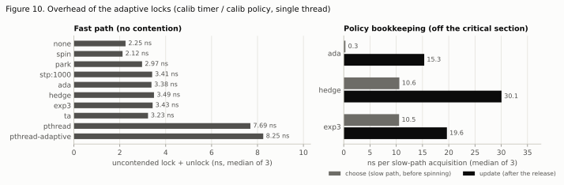
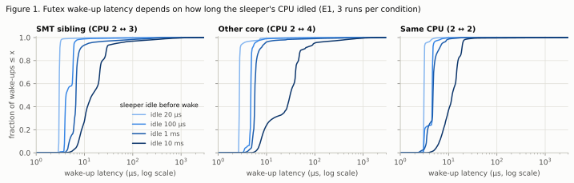
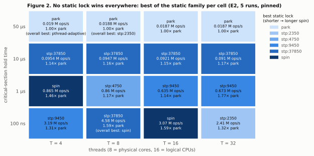
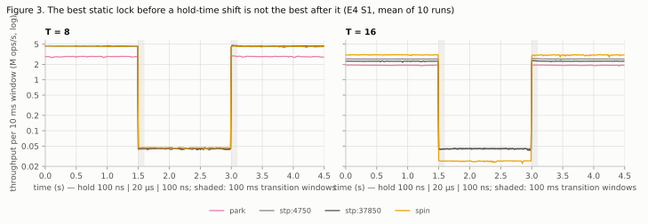
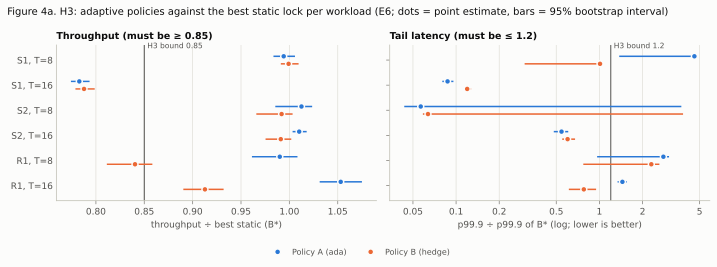
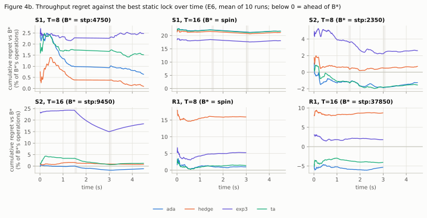
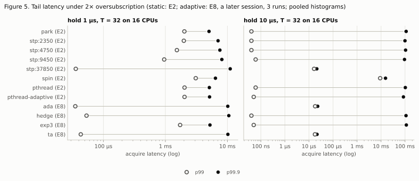
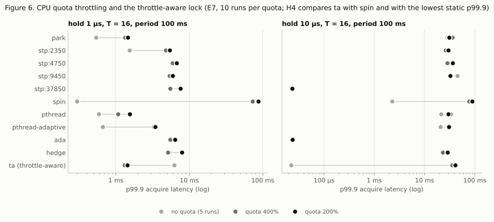
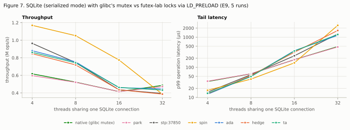

# When Should a Thread Wait? An Experimental Study of Linux Futex-Based Synchronization Under Changing Contention

*Working subtitle: Learning When to Park: Spin-Then-Wait Locking on Linux Futexes Under Non-Stationary Contention and CPU Throttling*

**Draft v1, 2026-10-16.** Team draft for internal review. Not for submission until the literature in §4 has been read
(see `docs/literature.md`) and a supervisor has reviewed it.

> **How to read this draft.** Every number in it comes from a generated file: a table under `docs/results/`, a figure
> under `docs/figures/` (each with a CSV twin), or `RESEARCH_PHASE.md` §3.4. The source is named next to the number.
> Confirmatory claims (H1–H4) follow the pre-registered rules (`prereg-v1`, `prereg-v1-p3`). Everything else is
> labelled *exploratory*. Statements about other papers' content are marked **[to read]** and must not stay in the text
> until a team member has read that source.

---

## Abstract

A thread that finds a lock held can spin, park in the kernel, or spin for a while and then park. The classic
spin-then-block analysis assumes a fixed, known cost of blocking. We measure that cost for Linux futexes on a
16-thread laptop CPU. We then ask whether a lock can choose its spin budget online when hold times, thread counts and
CPU quotas change.

**Wake-up cost is not a constant.** The median futex wake-up latency ranges from 2.7 µs to 30.7 µs depending on how
long the sleeper's CPU idled: 11.3× (H1 supported). Tails reach milliseconds.

**Static budgets go stale only some of the time.** With one thread per physical core, a static budget lost at most
3.2% throughput when the hold time shifted between 100 ns and 20 µs. With all 16 hardware threads busy, the best
static lock lost 43% after the shift (H2 partially supported, 2 of 4 cases).

**Two online policies.** We built an estimate-and-set policy (budget = 8 × the wake-up latency measured inside the
lock) and a Hedge learner over six budgets.

- *Policy A* stays within 0.99–1.05× of the best static lock's throughput on five of six phase-changing and
  randomized workloads. On the steady grid it is within 0.97–1.04× in 15 of 16 configurations.
- *The remaining throughput miss is structural.* No spin budget lets our futex lock match a separate test-and-set
  spin lock at 16 threads.
- *H3 is only partially supported for either policy* (A: 1 of 6 workloads met; B: 3 of 6). Most misses are on the
  pre-registered p99.9 bound.

**Throttling.** A throttle-aware variant reads the cgroup's CPU counters and parks when throttling is recent or
imminent.

- At 1 µs holds it matches the best static p99.9 and is 55–61× better than spinning. At a 400% quota it prevents
  throttling altogether.
- At 10 µs holds, forced parking is the wrong choice (H4 partially supported, 2 of 4 cases).

**Methodology warning.** Pooled per-acquisition tail quantiles reward *barging*: a releaser re-takes the lock before
parked waiters wake. The futex locks with the best p99.9 in these cases left at least one thread with zero
acquisitions in most runs.

**Real application.** In SQLite with one shared connection, run through an LD_PRELOAD shim, spinning is 1.9–2.0×
faster than glibc's mutex up to 16 threads, and Policy A is 1.1–1.4× faster. At 32 threads only the shortest static
budget beats glibc (1.11×).

---

## 1. Introduction

Mutexes on Linux are built on futexes: a 32-bit word in user memory plus a kernel wait queue that is used only to sleep
or wake. When a lock is contended, the waiter must choose between burning CPU and paying the kernel's sleep/wake
cost. The classic answer is the ski-rental rule: spin for about as long as blocking costs, then block, which is within
a factor of two of the best offline choice when that cost is fixed and known [L4, L12: to read].

Three things make the cost neither fixed nor known on a modern Linux machine:

1. **Wake-up latency depends on idle state.** A parked thread's CPU may sit in a deep C-state.
2. **The best choice depends on the workload.** It changes with thread count and hold time, and both can change
   during a run.
3. **cgroup CPU quotas throttle the whole group.** Under a quota, time spent spinning is time the lock holder cannot
   use.

We ask three research questions:

- **RQ1.** What does the futex wake-up cost distribution look like across CPU placement, idle state and load?
- **RQ2.** How much do static spin budgets lose when hold times or contention shift during a run?
- **RQ3.** Can an online policy stay within a bounded factor of the best static budget in hindsight, and does this hold
  in practice, including under CPU throttling?

**Contributions** (written last, matched to the evidence):

1. **A measured wake-up cost distribution.** On a Ryzen 7 6800H, futex wake-up medians range from 2.7 to 30.7 µs
   across placement and idle depth, with millisecond tails (§7.1).
2. **A pre-registered test of static budgets under shifting holds.** The loss appears when all hardware threads are
   busy (43%) but not at one thread per core (≤ 3.2%) (§7.2).
3. **Two adaptive locks, sharing a ski-rental cost model and an in-lock wake-up measurement.**
   - Policy A matches the best static lock's throughput almost everywhere.
   - The Hedge learner's censored-feedback imputation biases it toward parking, a negative result we can explain
     (§7.3).
4. **A user-space throttle-aware lock.** It helps when parking is the right answer and hurts when it is not. Its 1 ms
   "imminent throttling" rule produces false positives (§7.4).
5. **A methodology result.** Pooled per-acquisition p99.9 rewards barging and hides complete starvation in futex
   locks; per-thread metrics are needed (§7.5).
6. **An LD_PRELOAD shim and a SQLite measurement.** These show the steady-sweep picture carries over to a real
   library: spinning wins up to the number of hardware threads, and under oversubscription only the shortest budget
   beats glibc (§7.6).

We do **not** claim that adaptive spinning is new. It is decades old [L4, G1: to read], and the kernel has had several
owner-aware proposals [G7: to read]. How far the online-learning and throttling angles are new is open until the
literature in §4 has been read.

## 2. Background

- **Futex locks.** Our locks use the three-state futex protocol: 0 = free, 1 = locked, 2 = locked with possible
  waiters [L1: to read; implementation in `src/lock_futex.c`]. Acquisition is one CAS in user space. A contended
  waiter optionally spins, sets the word to 2 and sleeps in `FUTEX_WAIT`. An unlock that finds 2 issues `FUTEX_WAKE`.
  A spinner may take a free word from 0 to 1 while sleepers exist. This is the barging that matters in §7.5.
- **Ski rental.** If a wait of length w costs w when spun through, and b + C when the waiter spins for b and then
  blocks at cost C, then b = C is 2-competitive [L4, L12: to read].
- **Experts and bandits.** Hedge keeps exponential weights over K options and updates every option from a full cost
  vector [L11: to read]. EXP3 updates only the chosen option, with importance weighting [L10: to read]. Discounting
  gives them a finite memory for non-stationary settings [G4: to read].
- **CFS bandwidth control.** A cgroup with `cpu.max` = quota/period may consume `quota` µs of CPU per period. Its
  threads are then throttled until the period ends; `cpu.stat` counts throttled periods and time [L3: to read].

## 3. System under test

| Lock | Spin budget |
|---|---|
| `park` | 0 (park immediately) |
| `stp:<ns>` | fixed: 2,350 / 4,750 / 9,450 / 37,850 ns = {½, 1, 2, 8} × the E1 reference median wake latency |
| `spin` | separate test-and-test-and-set lock, exponential backoff capped at 16 `pause`, never parks |
| `pthread`, `pthread-adaptive` | glibc 2.44 default and `PTHREAD_MUTEX_ADAPTIVE_NP` (external baselines) |
| `ada` (Policy A) | β × Ŵ, capped at 151.3 µs; Ŵ = EWMA of wake-up latency measured in the lock |
| `hedge` (Policy B) | drawn per slow path from Hedge weights over {0, 2.35, 4.75, 9.45, 37.85, 151.3} µs |
| `exp3` | as hedge, bandit feedback only (exploratory) |
| `ta` | base policy + cgroup throttle detector: budget 0 while throttling is recent or imminent |

**The shared cost model.** cost(b) = w if w ≤ b, else b + C, with C = β·Ŵ (`src/policy.h`).

- *The β parameter.* β is the only tuned parameter. It turns the measured wake latency into the full cost of a park:
  the releaser's `FUTEX_WAKE`, the lost turn, and cache refill.
- *Hedge's feedback.* Hedge uses the full counterfactual cost vector. It is exact for acquisitions made while
  spinning. For parked acquisitions, the costs of longer arms are imputed from the release that admitted the waiter.
- *Throttle detection.* The detector polls the process's own `cpu.stat` every 1 ms when a quota is set. A new throttle
  event, or usage ≥ 90% of the quota, starts park mode for 1–64 quota periods, with doubling after failed probes.
- *Overhead.* All policy state is per thread. The update runs after the release.
  - Uncontended lock+unlock: 3.2–3.5 ns, against 2.97 ns for `park`.
  - Per slow path: 0.3–10.6 ns to choose a budget and 15–30 ns to update (Figure 10;
    `results/overhead/`).
- *Correctness.* All locks pass an exact-counter test at 2, 8 and 32 threads (39/39), under ThreadSanitizer and, for
  `ta`, inside a 50% CPU quota.

<picture><source media="(prefers-color-scheme: dark)" srcset="figures/fig10-overhead-dark.svg"></picture>

## 4. Related work

*This section is a skeleton by design.* The bibliographic details of every source below are verified
(`docs/literature.md`), but no source has been read by the team yet. The sentences marked [to read] state only *why* a
source is relevant. They must be rewritten from the papers themselves before submission, following
`RESEARCH_PHASE.md` §4.3: what each studied, what it leaves open relative to RQ1–RQ3, and how our setup differs.

- **Competitive and adaptive spinning.**
  - Karlin et al. (SOSP 1991) [L4, to read]: competitive spin-then-block strategies.
  - Lim and Agarwal (ASPLOS 1994) [G1, to read]: reactive switching between synchronization protocols.
  - Our Policy A is close to the classic rule. How it differs (a wake-up cost measured inside the lock, a budget
    multiplier tuned once) must be stated against these papers.
- **Kernel-side adaptive futexes.**
  - Hart's 2010 `FUTEX_LOCK` series with optional adaptive spinning [G7a, to read].
  - Long's 2014 optimistic-spinning futex [G7b, to read].
  - Almeida's 2024 `FUTEX_SPIN` RFC [G7c, to read].
  - These spin while the owner is running, which needs information a user-space lock lacks. This contrast is a
    candidate framing for our work.
- **Lock studies on real software.**
  - Guiroux et al. (ATC 2016; TOCS 2019) [L5, L6, to read] and David et al. (SOSP 2013) [L7, to read] compare many
    lock algorithms.
  - Falsafi et al. (ATC 2016) [L8, to read] study the energy side.
  - Our shim follows the interposition approach [L5, to read].
- **Fairness and concurrency restriction.**
  - Mellor-Crummey and Scott (TOCS 1991) [L9, to read]: queue locks.
  - Dice (EuroSys 2017) [G2, to read]: Malthusian locks.
  - Patel et al. (EuroSys 2020) [G3, to read]: scheduler-cooperative locks.
  - The barging/starvation finding (§7.5) must be compared with these before it is presented as more than a
    confirmation.
- **Throttling and lock-holder preemption.**
  - Uhlig et al. (VM 2004) [G5, to read]: lock-holder preemption in virtual machines.
  - Recent kernel work defers CFS throttling of tasks that hold kernel locks [G8, to read].
  - Ugedal et al. (SBAC-PAD 2022) [G6, to read]: CFS bandwidth throttling behaviour.
- **Bandits.** Hedge [L11], EXP3 [L10] and discounted or sliding-window variants [G4], all to read; textbooks [L12,
  L13].
- **Methodology.** Mytkowicz et al. (ASPLOS 2009) [L15, to read], whose setup randomisation we follow by randomising
  run order, and Hoefler and Belli (SC 2015) [L16, to read].

## 5. Methodology

**Machine.** One laptop:

| Component | Detail |
|---|---|
| CPU | AMD Ryzen 7 6800H, 8 cores / 16 threads, one socket and one L3 |
| Kernel | Linux 7.2.5 (Omarchy/Arch) |
| Libraries | glibc 2.44, gcc 16.2.1 `-O2` |
| Frequency | governor `performance`, turbo boost **on** (a recorded deviation) |
| cgroups | v2, with the `cpu` controller delegated to the user |

Machine manifests are in `results/manifests/` and in every session file.

**Harness.** `src/bench.c`. Each thread repeats: lock, calibrated hold work, unlock, calibrated think work (1 µs unless
stated).

- *Timing.* Acquire latency is TSC-stamped around `lock()`. Histograms have 0.8% buckets, merged across threads and
  runs.
- *Pinning.* Threads are pinned one per physical core first.
- *Warm-up and windows.* 200 ms warm-up; 10 ms throughput windows.
- *Validity.* Every run checks mutual exclusion with a non-atomic counter that must equal the number of acquisitions.
  No run was ever invalid for that reason.
- *Validation.* The harness itself was validated before any data (`docs/validation.md`, 15/15 checks).

**Workloads** (RESEARCH_PHASE §5.7):

| Name | What it is |
|---|---|
| Steady | One hold time and thread count |
| S1 | Hold 100 ns → 20 µs → 100 ns |
| S2 | Active threads T/4 → T → T/4 at a 1 µs hold |
| R1 | Hold 200 ns, or 20 µs with probability 0.1; exponential think time, mean 2 µs |
| Throttled | Steady, inside a systemd transient scope with `CPUQuota` 200% or 400%, period 100 ms |

S1 and S2 phases last 1.5 s each, and the first 100 ms after a shift is excluded.

**Procedure and statistics.**

- *Pre-registration.* Hypotheses, thresholds, definitions and the experiment matrix were tagged `prereg-v1` before
  any data. The Phase 3 protocol and tuned parameters were tagged `prereg-v1-p3` before any H3/H4 data.
- *Run order and calibration.* Runs execute in a seeded random order. One calibration is shared per session.
- *Tail latency.* Tail quantiles come from histograms pooled over runs.
- *Intervals.* Bootstrap over runs, 2,000 resamples (reduced from 10,000; a recorded deviation).
- *Verdict rule.* The point estimate decides; a 95% interval containing the threshold makes a case inconclusive.
- *Supplementary tests.* Mann–Whitney U with effect sizes for the pre-declared comparisons only
  (`docs/results/supplement.md`). They do not change verdicts.
- *Run counts.* 5–10 runs per configuration (the plan's 30 was cut for time; recorded as D2).
- *Tuning set.* Adaptive parameters were tuned only on steady T = 4 workloads (session T3).

## 6. Experiments

| ID | What | Runs | Source |
|---|---|---|---|
| E1 | Wake-up latency: 3 placements × 4 idle times (+2 loaded) | 42 | `docs/results/e1.md` |
| E2 | Steady sweep, 8 locks × 4 holds × T ∈ {4, 8, 16, 32} | 640 | `docs/results/e2.md` |
| E3 | Unpinned subset | 96 | `docs/results/e3.md` |
| E4 | S1, S2 phase changes (H2) | 320 | `docs/results/e4.md` |
| E5 | R1 randomized | 160 | `docs/results/e5.md` |
| T3 | Tuning, steady T = 4 | 320 | `docs/results/t3.md` |
| E6 | H3: S1, S2, R1 × T ∈ {8, 16}, static and adaptive interleaved | 720 | `docs/results/e6.md` |
| E7 | H4: throttled steady runs (+ unthrottled reference) | 550 | `docs/results/e7.md` |
| E8 | Adaptive locks on the steady grid (exploratory) | 288 | `docs/results/e8.md` |
| E9 | SQLite through the LD_PRELOAD shim (exploratory) | 220 | `docs/results/e9.md` |

That is 3,356 runs in total. None was invalidated by the mutual-exclusion check. Process failures caused 3 retries: a
launcher path bug in E9's first session, logged in `PROGRESS.md`.

## 7. Results

### 7.1 RQ1: the cost of a wake-up (E1, H1)

<picture><source media="(prefers-color-scheme: dark)" srcset="figures/fig1-wake-cdf-dark.svg"></picture>

**H1 SUPPORTED.**

- The slowest unloaded condition (other core, 10 ms idle, median 30.72 µs) is **11.27×** the fastest (other core,
  20 µs idle, 2.73 µs). The conservative 95% interval is 11.18–11.37 against a threshold of 2×.
- Even the most pessimistic pair of per-run medians gives 9.59×.
- The supplementary test agrees: probability of superiority A = 0.996 (`docs/results/e1.md`, `supplement.md`).

Descriptively:

- **Idle depth drives the median.** The longer the sleeper's CPU idled, the slower the wake.
- **Tails are heavy and grow with idle depth.** For the SMT-sibling and other-core placements, p99/p50 is 1.3–2.7 at
  20 µs idle and 15–36 at 1–10 ms idle.
- **The releaser pays too.** Its `FUTEX_WAKE` call itself takes a median of 0.56–3.5 µs across placements, and up to
  8.3 µs when waker and sleeper share a CPU.
- **Inside a contended lock the cost is the same order.** The wake latency measured by `ada` is 1.4–5.2 µs in the
  configurations with enough samples (`docs/results/e8.md`).

A blocking cost that varies 11× with idle state is the premise of the adaptive locks.

### 7.2 RQ2: static budgets under shifting workloads (E2, E4, H2)

<picture><source media="(prefers-color-scheme: dark)" srcset="figures/fig2-best-lock-map-dark.svg"></picture>

**No static lock wins everywhere** (Figure 2, `docs/results/e2.md`). By the pre-registered best-static rule (ties
within 1% go to the lower p99), the best member of the static family is:

- spin in 2 of 16 cells;
- one of the stp locks in 10;
- park in the four 50 µs cells, where every futex lock is within about 2% and the tie rule picks park.

Spinning collapses under oversubscription. At T = 32 with 1 µs holds, spin reaches 0.23 M ops/s against `stp:9450`'s
0.67 M ops/s.

<picture><source media="(prefers-color-scheme: dark)" srcset="figures/fig3-phase-change-dark.svg"></picture>

**H2 PARTIALLY SUPPORTED (2 of 4 cases)** (`docs/results/e4.md`).

| Case | Loss after shift | p99 ratio | Result |
|---|---|---|---|
| T = 8, both shifts | 1.8–3.2% | ≤ 1.64 | not met |
| T = 16, 100 ns → 20 µs | **43.1%** (spin, best before) | – | met |
| T = 16, 20 µs → 100 ns | – | **2.59×** (the best long-hold lock) | met |

- At T = 8 the losses are statistically detectable (Holm p = 0.011 for the 3.2% case) but far below the 25%
  threshold. This is the distinction between statistical and practical significance that the pre-registered bound
  was meant to draw.
- Figure 3 shows the mechanism. At T = 8 every spinning lock coincides in both phases. At T = 16 spin is best in short
  phases and worst in the long one.

### 7.3 RQ3: adaptive policies against the best static lock in hindsight (E6, H3)

<picture><source media="(prefers-color-scheme: dark)" srcset="figures/fig4a-h3-ratios-dark.svg"></picture>

**H3: PARTIALLY SUPPORTED for both policies** (RESEARCH_PHASE §3.4, `docs/results/e6.md`).

| Workload | B\* | A: throughput / p99.9 ratio | B: throughput / p99.9 ratio | A | B |
|---|---|---|---|---|---|
| S1 T=8 | stp:4750 | 0.994 / 4.60 | 0.999 / 1.01 | not met | met |
| S1 T=16 | spin | 0.783 / 0.09 | 0.788 / 0.12 | not met | not met |
| S2 T=8 | stp:2350 | 1.013 / 0.06 | 0.992 / 0.06 | inconclusive | inconclusive |
| S2 T=16 | stp:9450 | 1.010 / 0.54 | 0.991 / 0.60 | met | met |
| R1 T=8 | spin | 0.990 / 2.79 | 0.840 / 2.30 | inconclusive | inconclusive |
| R1 T=16 | stp:37850 | 1.053 / 1.45 | 0.913 / 0.78 | not met | met |

Policy A met 1 of 6 cases (3 not met, 2 inconclusive); Policy B met 3 of 6 (1 not met, 2 inconclusive).

1. **Throughput: Policy A keeps up.**
   - It is within 0.99–1.05× of B\* on five workloads and ahead of B\* on three of them.
   - On the steady grid (E8, exploratory, compared with E2), it is at 0.97–1.04× of E2's best static lock in 15 of 16
     cells. The two park/spin anchors put the session drift at 0–3%.
2. **The S1 T=16 miss is structural.** B\* is the separate spin lock. In the 100 ns phases, every spin-then-park lock
   reaches only 0.76–0.87× of it, including `stp:37850`, which almost never parks. The gap lies in the futex lock's
   spin loop, so no budget can close it.
3. **The p99.9 misses are the barging effect of §7.5.**
   - In S1 at T = 8, the span's p99.9 is set by the 20 µs phase, where B\* barges (p99.9 60 ns in that phase) and
     Policy A spins for its turn (47 µs).
   - Policy B passes S1 T=8 for the same reason Policy A fails: its short-arm draws park and barge.
4. **The two inconclusive cases come from B\* switching between static locks** in the bootstrap (54% / 77% of
   resamples), whose p99.9 values differ about 10×. With B\* held fixed (a sensitivity view, not the verdict), A would
   meet 2 of 6 and B 4 of 6.
5. **Policy B's censored-feedback imputation leans toward parking.**
   - On R1 it put 97–99% of slow paths on the 2.35 µs arm and used 2.0 CPU cores instead of B\*'s 8.0. It gave up
     16% of the throughput at T = 8.
   - The imputed wait of a parked waiter includes the time it lost to barging, which makes long arms look expensive.
   - EXP3, without imputation, kept spinning and reached 0.95× there.

<picture><source media="(prefers-color-scheme: dark)" srcset="figures/fig4b-regret-dark.svg"></picture>

**Regret over time (Figure 4b).**

- Policy A ends between −5.3% (ahead) and +1% of B\*'s operations on five workloads, and at +21.7% on S1 T=16.
- In the policies' own cost model, Hedge's regret against its best fixed arm is −191 to +38 ns per slow path. That is
  small, but small *in a model that does not capture throughput*. This is the gap between a no-regret guarantee and
  the outcome that matters.

<picture><source media="(prefers-color-scheme: dark)" srcset="figures/fig5-oversubscription-dark.svg"></picture>

**Oversubscription (Figure 5, exploratory).**

- At T = 32 with 10 µs holds, every lock that parks shows a p99 of about 40–60 ns and a p99.9 of about 100 ms. This
  is a barging signature: almost all acquisitions are uncontended re-acquisitions, and the rest wait very long.
- The long-budget locks (`stp:37850`, `ada`, and `ta`, which runs Policy A there) have p99 and p99.9 within 2× of
  each other, at about 20 µs.

### 7.4 Throttling (E7, H4)

<picture><source media="(prefers-color-scheme: dark)" srcset="figures/fig6-throttling-dark.svg"></picture>

**H4 PARTIALLY SUPPORTED (2 of 4 cases)** (`docs/results/e7.md`).

- **Quotas inflate the tails of spin-heavy locks.** Spin's p99.9 goes from 297 µs without a quota to 87.7 ms at 200%
  (1 µs holds).
- **1 µs holds, both quotas: met.** The throttle-aware lock stays in park mode, matches the best static p99.9
  (park's: ratio 0.98–0.99) and is 55–61× better than spin. At 400% its imminent-throttling rule keeps the group from
  being throttled at all (0% of periods, 2.1 cores, p99.9 1.32 ms), while Policy A without detection uses 4.0 cores,
  is throttled in every period and has p99.9 5.52 ms.
- **10 µs holds, both quotas: not met.**
  - The best static lock is `stp:37850`, which spins through the holds on about 2 cores and stays near the quota.
  - Forced parking puts `ta` into the barging regime: p99.9 36–41 ms, against 23 µs for `stp:37850`. The ratio to
    spin (2.17) is inconclusive.
- **The detector has a false-positive weakness.** At 400% with 10 µs holds, the group was never throttled, yet `ta`
  spent about 2.1 s of its 2.2 s life in park mode: 1 ms usage spikes crossed 90% of the quota while the average did
  not. Measuring usage against the quota within the current period is the obvious next design (future work; not
  tested here).

### 7.5 Barging and starvation: what pooled tail latency hides (exploratory)

Table 8 (`docs/figures/tables.md`) counts the runs in which an active thread got **zero** acquisitions in a measured
phase.

| Lock | E6 S1 T=8 | E6 S1 T=16 | E7 10 µs, 400% |
|---|---|---|---|
| `ada` | 10 of 10 runs | 10 of 10 | 10 of 10 |
| `ta` | 10 of 10 | 10 of 10 | 0 (it parks here) |
| `stp:4750` | 4 | 6 | 0 |
| `stp:37850` | 5 | 6 | 10 of 10 |
| park, pthread, pthread-adaptive | 4–5 | 2–8 | 0 |
| spin | 0 | 0 | 0 |

All starvation in E6 happens in S1's 20 µs phase. **The locks with the best pooled p99.9 in E7 at 10 µs holds are the
ones that starve threads.** Their waiting-time-weighted p99 is 1.1–1.5 s without a quota, against 2.3 ms for spin.

**Mechanism** (consistent with the counters; not yet traced). A woken waiter needs 3–30 µs to run (E1), while the
releaser re-acquires through the fast path within its 1 µs think time. A thread that spins long enough to see the word
at 0 wins; a parked thread, woken late, loses repeatedly.

**Consequence.** Per-acquisition quantiles count the barger's many fast acquisitions and almost none of the starved
thread's. Any tail comparison of futex locks under long holds needs a per-thread view next to the pooled quantile.
The pre-registered H2–H4 verdicts are kept as computed, and this caveat applies to all of them.

### 7.6 A real application: SQLite through an LD_PRELOAD shim (E9, exploratory)

<picture><source media="(prefers-color-scheme: dark)" srcset="figures/fig7-sqlite-dark.svg"></picture>

**Setup.** T threads share one in-memory SQLite connection in serialized mode, so every API call takes the
connection's recursive mutex. Each operation is a point SELECT (90%) or an UPDATE (10%). `src/shim.c` maps each
`pthread_mutex_t` to a futex-lab lock (`docs/results/e9.md`). Every run passed the SUM(v) = #UPDATE check.

**Throughput relative to glibc's mutex ("native"):**

| T | spin | `ada` | `stp:2350` | Others | p99 |
|---|---|---|---|---|---|
| 4 | 1.89× | 1.43× | 1.51× | park 0.97× | `ada` 12.7 µs vs native 33.6 µs |
| 8 | 2.01× | 1.44× | 1.39× | park 1.00× | `ada` 50.2 vs 60.8 µs |
| 16 | 1.87× | 1.11× | 1.36× | – | `ada` 355 vs 179 µs |
| 32 | 0.79× | 0.92× | 1.11× (best) | Hedge 0.80×, park 0.97× | `ada` 1.15 ms vs 0.49 ms |

- **Up to T = 16, spinning wins clearly.** Our `park` behaves like glibc's mutex, as expected from the same
  three-state design.
- **At T = 32 the ranking reverses.** Every long-spinning lock loses, and `ada`'s budget fell from 45 µs (T = 8) to
  16 µs (T = 32) without reaching parity.
- **Overall pattern.** The steady-sweep picture from E2 reappears in a real library. Short budgets win under
  oversubscription; long budgets and spinning win below it.

## 8. Discussion

**When does adaptation help?** When the workload stays within the regime the policy was tuned for, it costs little.

- Policy A, tuned at T = 4, behaves like the best static lock wherever spinning through the wait is right.
- It cannot see costs that spinning creates for *other* threads: SMT contention at T = 16, preempted holders at
  T = 32, and quota at 200%.
- A per-waiter ski-rental cost model has no term for those costs. This is the most important design lesson.

**Why did learning not beat estimating?** Hedge's no-regret property holds in its own cost model, where its regret was
indeed near zero. That model is biased in two ways:

- Parked waiters' imputed waits include barging losses.
- Spinning is charged as if CPU were scarce even when it is free.

A policy that learns from *throughput* (a slower, bandit-style signal over epochs), or one that knows whether the
owner is running (as kernel proposals do [G7: to read]), are the natural next steps.

**Throttling.** The throttle-aware idea works when parking is the right answer anyway, and it then prevents throttling
outright. When spinning is right, forcing parks reintroduces barging. A detector that compares usage with the
remaining quota in the current period should remove the false positives seen at 400%.

**Practical guidance from these data** (one machine):

- Use a bounded spin budget, roughly 1 to 8 wake-up latencies, when threads ≤ hardware threads. Spinning through
  the expected wait is what wins there.
- Under oversubscription, never spin unboundedly. The best budget still depends on the hold time: E2 at T = 32
  favours ½ to 8 wake-ups, and SQLite at T = 32 favours ½.
- Never spin unboundedly under a CPU quota.
- Report per-thread latency or starvation counts with any tail metric.

## 9. Threats to validity and limitations

- **One laptop** (single socket, SMT on, turbo boost on). The clock fell about 3% on average during runs, and drift
  covariates are recorded. No second machine was used, so the generality of every number is unknown.
- **Few repetitions.** 3–10 runs per configuration instead of 30. Per-run tail quantiles are noisy, which is why
  verdicts use pooled histograms, but these are sensitive to rare events (and to barging).
- **Weak tuning set.** T = 4 cannot reveal costs that appear only at higher thread counts. The policies were
  therefore tuned toward long spinning.
- **Prior knowledge when designing.** The Phase 2 results were known when the policies were designed (disclosed in
  §5.8). Some exploratory analyses (starvation counts, B\*-fixed sensitivity) were added after the H3/H4 data and are
  labelled as such.
- **Synthetic workloads and one application configuration.** The shim does not support condition variables or robust
  mutexes. Policy state is per thread and resets when a thread contends on a different lock (not an issue in our
  workloads, where one lock dominates).
- **Wake latency is measured from the releaser's stamp.** That stamp can be overwritten by a later release, which
  underestimates the latency.
- **Not done:** wake-up latency under throttling (RQ1 lists it), energy, a second machine.
- **Literature not yet read** (§4). The novelty of the online-learning and throttling angles is unconfirmed.

## 10. Conclusion and artifact

- Futex wake-up cost varies by an order of magnitude with idle state.
- Static spin budgets go stale when contention changes, mainly once all hardware threads are busy.
- A simple estimate-and-set policy with an in-lock wake-up measurement tracks the best static budget's throughput
  closely but not universally. A Hedge learner over budgets did not improve on it, because of a bias in its
  counterfactual costs.
- A user-space throttle-aware lock helps exactly when parking is right.
- The most robust finding is methodological: per-acquisition tail quantiles of futex locks reward barging, so tail
  comparisons need per-thread metrics.

**Artifact.** The repository contains:

- every lock, the harness and the shim (`src/`);
- the experiment matrix and runner (`scripts/experiments.py`, `scripts/run_experiments.py`);
- raw data for 3,356 runs (`results/`);
- analysis and figure scripts;
- the pre-registration tags `prereg-v1` and `prereg-v1-p3`;
- the data-freeze tag `data-freeze-v1`.

`README.md` §14 maps every figure and table to the command that regenerates it.

## Figures and tables index

| # | Planned (RESEARCH_PHASE §7) | File |
|---|---|---|
| 1 | Wake-up latency CDFs | `docs/figures/fig1-wake-cdf.svg` (+ `-dark.svg`, `.csv`) |
| 2 | Best lock vs hold time and threads | `fig2-best-lock-map` |
| 3 | Throughput over time across phase changes | `fig3-phase-change` |
| 4 | Adaptive vs best static; regret | `fig4a-h3-ratios`, `fig4b-regret` |
| 5 | p99/p99.9 under oversubscription | `fig5-oversubscription` |
| 6 | Throttled vs unthrottled, incl. throttle-aware | `fig6-throttling` |
| 7 | Real application | `fig7-sqlite` |
| 8 | Fairness table | `docs/figures/tables.md`, Table 8 |
| 9 | Hypothesis summary | `docs/figures/tables.md`, Table 9 = RESEARCH_PHASE §3.4 |
| 10 | Policy overhead | `fig10-overhead` |
